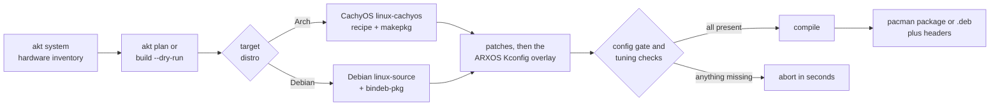

<div align="center">



<br>

[](https://github.com/0xb0rn3/kernel-builder/actions/workflows/ci.yml)
[](https://github.com/0xb0rn3/kernel-builder/releases)
[](https://www.gnu.org/licenses/gpl-3.0.html)


**Detect the machine. Plan the build. Prove the hardening before the compile.**

[Quick start](#quick-start) | [Commands](#commands) | [Flavors](#flavors) | [Config gate](#the-config-gate) | [GUI](#local-gui) | [Cross-target builds](#cross-target-builds) | [Patches](#patches) | [Install](#install-and-configuration)

<sub>An <a href="https://arxos.uk">ArxOS</a> tool by <a href="https://stingraylabs.pages.dev">Stingray Labs</a></sub>

</div>

<br>

## What it does

`akt` is a single Rust binary (standard library only, no crates) that builds a tuned Linux kernel package for **Arch-family** or **Debian-family** systems. It reads the hardware it is running on, turns that into a conservative build plan, applies the ARXOS Kconfig overlay, and then checks the resulting `.config` before it spends hours compiling.

| | |
|---|---|
| 🔍 **Hardware-aware** | Reads CPU flags, RAM, cgroup limits, free disk, thermal sensors, CPU-frequency policy and battery state. Anything the machine does not expose is reported as *unknown*, never guessed. |
| 🧮 **Resource-aware builds** | Sizes `make` and ThinLTO parallelism from CPUs, available RAM, cgroup v2 limits and disk, so a build does not take the machine down. |
| 🚦 **Config gate** | Re-asserts the hardening options after `olddefconfig` and hard-verifies them in `.config`. A missing option aborts in seconds, not after a multi-hour compile. |
| 🔐 **Supply-chain posture** | Pinned CachyOS signing-key fingerprints, BLAKE2 checksums derived from upstream `.SRCINFO`, strict patch application, optional `SHA256SUMS` for patch sets. `makepkg` integrity checks are never skipped. |
| 📦 **Both package families** | Arch builds a `pacman` package from the CachyOS `linux-cachyos` recipe. Debian builds `.deb` image and header packages from Debian kernel source. |
| 🐳 **Cross-target builds** | Build the other family's package in a disposable Podman or Docker container, without installing its toolchain on your host. |
| 🖥️ **Local GUI** | Loopback-only web UI with a live build log, driven by the same engine as the CLI. No telemetry. |
| ⏪ **Rollback** | Each build archives the package it supersedes into `prev/`. `akt rollback` reinstalls it (Arch path). |

> [!NOTE]
> This repository is the **kernel builder**, not a prebuilt ArxOS kernel. What you get depends on the selected source, flavor and your hardware. See [Safety and limitations](#safety-and-limitations) before installing anything.

## A quick look

<div align="center">

</div>

<sub>Illustrative session. The `tune` line is omitted for width; all other lines use the tool's real output format.</sub>

## Quick start

**1. Install** (a release bundle needs no Rust toolchain):

```sh
tar xf kernel-builder-v<version>-x86_64-linux.tar.gz
cd kernel-builder
./install.sh --user          # or --standalone / --system; see "Install" below
```

**2. Look before you build:**

```sh
akt system                   # hardware inventory and recommendations
akt plan                     # what a build would do on this host
akt build --dry-run          # plan plus the resource check; compiles nothing
```

**3. Build** (long: expect hours on a laptop):

```sh
akt build --cpu-target portable --max-jobs 4 --thinlto-jobs 2 --hz 500
```

**4. Install the result in a throwaway VM first**, then on real hardware:

```sh
sudo pacman -U linux-arxos-*.pkg.tar.zst linux-arxos-headers-*.pkg.tar.zst     # Arch family
sudo dpkg -i linux-image-*-arxos*.deb linux-headers-*arxos*.deb                  # Debian family
```

Prefer a window to a terminal? Run `akt gui`.

## How a build flows



<details>
<summary><b>Stage by stage: what each path actually runs</b></summary>

<br>

| Stage | Arch family | Debian family |
|---|---|---|
| **Source** | Clone or fast-forward `CachyOS/linux-cachyos`. With `--source-ref`, fetch and check out that ref detached; it is never pulled forward. | `sudo apt-get install linux-source` plus build dependencies, then extract the source tarball. |
| **Preparation** | Cap the recipe's `nproc` jobs, rebuild the PKGBUILD `b2sums` from matching `.SRCINFO`, import any missing **pinned** CachyOS signing keys, then `makepkg -o` downloads and verifies sources. `--prepare-only` stops here. | Seed `.config` from `/boot/config-$(uname -r)` (falls back to `make defconfig`). |
| **Tuning** | CachyOS PKGBUILD variables: `_cpusched`, `_use_llvm_lto`, `_HZ_ticks`, `_processor_opt`, `_hugepage`, `_per_gov`, `_use_kcfi`, `_tcp_bbr3`, `_preempt`. | `scripts/config` sets HZ, BBR, THP, MGLRU, the x86-64 level, governor, and LTO / PREEMPT_RT / kCFI where the source supports them. BORE is enabled only if the source contains it. |
| **Patches** | Bundled `patches/arxos/`, then your `--patch` inputs. Integrity check first, then apply. | Bundled `patches/arxos/` and `patches/kali/`, then your `--patch` inputs. |
| **Overlay and gate** | Merge `config/arxos.fragment`, `olddefconfig`, re-assert the hardening options, then verify the gate and the requested tuning. | Same. |
| **Compile** | Re-detect resources, cap ThinLTO backends in the kernel Makefile, `makepkg -e -f`. | `make bindeb-pkg` (with `LLVM=1` for ThinLTO flavors). |
| **Tidy** | Superseded artifacts move to `prev/`; packages move to `--out` if given. | Same. |

</details>

## Commands

| Command | What it does |
|---|---|
| `akt detect` | Host distro and the native build path. |
| `akt system` | Hardware inventory with per-machine recommendations. Alias: `recommend`. |
| `akt resources` | CPU, RAM, cgroup and disk build plan for the `AKT_WORK` directory. Applies the full-build 60 GiB disk floor, so it errors on a smaller disk; use `build --dry-run` to see a plan regardless. |
| `akt plan` | Print the resolved plan. Builds nothing. |
| `akt patches` | List every patch that would be applied, in order. |
| `akt explain` | Plain-English meaning of each performance, hardening and security option. |
| `akt build` | Build a kernel package. Supports `--dry-run` and `--prepare-only`. |
| `akt gate <config>` | Verify the hardening delta in a `.config`. Exits non-zero on failure. |
| `akt rollback` | Reinstall the previous `linux-NAME` package from `prev/` (Arch path). |
| `akt gui` | Start the local web UI (default `http://127.0.0.1:8787`, `--port N`). |
| `akt version` | Print the version (`--version` and `-V` also work). |

`--json` is available on `detect`, `system`, `resources`, `plan`, `patches`, `explain` and `gate` for scripting.

<details>
<summary><b>Build options</b></summary>

<br>

| Option | Values | Default | Notes |
|---|---|---|---|
| `--target-distro` | `host`, `auto`, `arch`, `debian` | `host` | A different target than the host uses Podman or Docker. |
| `--flavor` | `default`, `rt`, `hardened` | `default` | See [Flavors](#flavors). |
| `--name`, `--rename` | 1 to 24 characters: lowercase letters, digits, dashes | `arxos` | Builds `linux-NAME`. No leading or trailing dash. |
| `--pkgrel` | digits | `1` | Package revision. |
| `--out` | directory | build directory | Where finished packages go. `--output` is rejected with a pointer to `--out`. |
| `--cpu-target` | `auto`, `portable`, `v1`, `v2`, `v3`, `v4` | `auto` | `auto` picks the highest x86-64 level this CPU reports. It is machine-specific, not portable. `portable` means `v1`. |
| `--hz` | `1000`, `750`, `600`, `500`, `300`, `250`, `100` | `1000` | Verified against the resolved `.config`. Debian source offers fewer tick choices. |
| `--hugepages` | `madvise`, `always` | `madvise` | Not applied to the `rt` flavor, which excludes THP. |
| `--performance-governor` | flag | off | Opt in to the performance governor as the kernel default. |
| `--max-jobs` | `auto`, positive integer | `auto` | An upper bound; the resource plan can only lower it. |
| `--thinlto-jobs` | `auto`, positive integer | `auto` | Independent cap on ThinLTO backends. |
| `--source-ref` | tag, branch or commit | rolling | Arch only. Letters, digits, `.`, `_`, `-`, `/`; up to 200 characters; no `..` or `//`. |
| `--patch` | file or directory | none | Repeatable. Applied after bundled patches, in the order given. |
| `--patch-optional` | flag | off | Skip patches that do not apply instead of aborting. |
| `--dry-run` | flag | off | Plan plus resource check. Compiles nothing. |
| `--prepare-only` | flag | off | Arch host and Arch target only. Download and verify sources, then stop. |

Neither `--dry-run` nor `--prepare-only` installs a kernel. A dry run reports the real disk capacity but does not enforce the 60 GiB full-build floor.

</details>

## Flavors

| Flavor | Scheduler | LTO | Intent |
|---|---|---|---|
| `default` | BORE | Clang ThinLTO | Balanced daily driver. |
| `rt` | BORE with PREEMPT_RT | none | Real-time. RT and LTO do not mix. Source support is required. |
| `hardened` | CachyOS hardened | Clang ThinLTO | Highest security posture: KSPP-style options plus kCFI. Requires a source whose config supports kCFI; Debian aborts if it does not. |

On the Arch target every flavor must resolve `CONFIG_SCHED_BORE=y`. On Debian, BORE is enabled only if the source already carries it, and any requested feature the source cannot provide fails verification rather than being reported as present.

> [!TIP]
> Pass the flavor name exactly. An unrecognized `--flavor` value currently falls back to `default`, so confirm with `akt plan --flavor <name>`: the header prints the flavor actually in use.

## The config gate

`olddefconfig` can silently revert options from a fragment, which once shipped a "hardened" kernel that quietly was not. So `akt` re-asserts the hardening delta with `scripts/config` and **hard-verifies it in `.config` at the config stage**, before any compile. `akt gate <config>` runs the same check on any file.

| Check | Why it is required |
|---|---|
| `CONFIG_INIT_ON_FREE_DEFAULT_ON=y` | Zero freed memory, so in-RAM key material cannot be scavenged from freed pages. |
| `CONFIG_INIT_ON_ALLOC_DEFAULT_ON=y` | Zero on allocation; removes a class of uninitialized-memory leaks. |
| `CONFIG_INTEL_IOMMU_DEFAULT_ON=y` | IOMMU enforcing at boot, against DMA-based RAM capture. |
| `CONFIG_IOMMU_DEFAULT_DMA_STRICT=y` | Strict IOMMU flushing. |
| `CONFIG_SECURITY_LOCKDOWN_LSM_EARLY=y` | Lockdown LSM available from early boot (it is not forced on; see below). |
| `CONFIG_IMA=y` | IMA measurement for measured boot. |
| `CONFIG_LIVEPATCH=y` | Live kernel patching. |
| `CONFIG_SECURITY_DMESG_RESTRICT=y` | Kernel log restricted to root. |
| `# CONFIG_HIBERNATION is not set` | No suspend-to-disk image that could hold plaintext keys. |

Beyond the gate, the build also verifies the tuning you asked for: `CONFIG_HZ`, the THP policy (not for `rt`), the performance governor, `CONFIG_X86_64_VERSION`, `PREEMPT_RT` for `rt`, `LTO_CLANG_THIN` for ThinLTO flavors, kCFI for `hardened`, and BORE where it applies.

> [!IMPORTANT]
> Passing the gate is a floor, not a security certification. It checks nine things; the overlay requests many more.

<details>
<summary><b>The Kconfig overlay at a glance</b> (<code>config/arxos.fragment</code>)</summary>

<br>

The overlay deliberately does **not** set the CachyOS performance knobs (BORE, ThinLTO, BBRv3, tick rate, preempt model, x86-64 level, MGLRU, THP). Setting them through `merge_config` would override CachyOS. It adds only what the base does not guarantee.

| Area | What it requests |
|---|---|
| **Memory and boot hardening** | `INIT_ON_ALLOC`/`INIT_ON_FREE`, hibernation off, strict IOMMU, early lockdown LSM (not forced), IMA measurement only (no appraisal, so it never blocks boot), `SECURITY_DMESG_RESTRICT`, KASLR, strict kernel RWX, no slab merging. |
| **Disk crypto** | `DM_CRYPT`, XTS, AES and AES-NI, SHA-256, crypto user API. |
| **Live patching** | `LIVEPATCH` with the ftrace options it needs. |
| **Network and anonymity tooling** | nftables, conntrack, NFQUEUE, TPROXY, NAT, WireGuard, network and user namespaces, TUN, AF_PACKET, XDP sockets. |
| **Wireless and radios** | `cfg80211`, `mac80211`, `carl9170`, Bluetooth, rfkill. Monitor mode and injection come from in-tree `mac80211` drivers; out-of-tree DKMS drivers are not part of this tool. |
| **USB and hardware work** | USB gadget with configfs HID, raw gadget, dummy HCD, USB serial (FTDI, CP210x, PL2303), CAN, UVC and GNSS as unbindable modules. |
| **Observability and DFIR** | eBPF with BTF and always-on JIT, kprobes, uprobes, function graph tracer, audit, fanotify, IKHEADERS, Yama, Landlock, BPF LSM, cgroup BPF. |
| **Virtualization and labs** | KVM (Intel and AMD) with vhost-net, veth, bridge, macvlan. |
| **Idle power** | TEO idle governor. |

Most of these are modules (`=m`), so they cost nothing until loaded. `akt explain` prints a plain-English description of each option group; note that its performance text describes the *default* profile, while `--cpu-target` and `--hz` change what is actually built.

</details>

## Resource planning

Build parallelism is calculated, not guessed. Detection runs before preparation and again before compilation.

| Input | Rule |
|---|---|
| **CPUs** | Logical CPUs available to the process (affinity and quotas respected); one is left free where possible. |
| **RAM** | `MemAvailable` (swap is not counted), further bounded by every visible cgroup v2 ancestor's `memory.max` and `memory.high`. Host reserve is a quarter of available memory, clamped to 512 MiB to 4 GiB. Each compile job is budgeted 2 GiB. |
| **Compile jobs** | `min(CPUs - 1, RAM budget, --max-jobs)`, never below 1. |
| **ThinLTO backends** | `min(jobs, 4, --thinlto-jobs)`. |
| **Disk** | At least 60 GiB free on the work filesystem for a real build. Large builds may need more. |

The Arch recipe's `nproc` calls and the Debian `make` invocation both use the calculated cap; ThinLTO flags are appended to the kernel Makefile without replacing architecture linker flags. A recipe or Makefile layout `akt` does not recognise stops the build for review instead of running uncapped. Cgroup v2 is required; an unsupported or unreadable layout fails with an explanation.

```sh
akt resources --json
AKT_WORK=/path/to/kernel-work akt build --max-jobs 4 --thinlto-jobs 2 --dry-run
```

The job ceilings that `akt system` prints use the same full-build disk policy, so they show as `unknown` when the work filesystem has under 60 GiB free.

Builds share a lock file in the work directory (`flock`, held by the build subprocesses too), so two builds can never mutate the same tree.

## Hardware inventory

`akt system` is read-only. It reports the OS, DMI machine model, CPU model and instruction flags, logical and physical cores, RAM and swap, CPU-frequency driver, governor and maximum, exposed thermal zones, DRM GPUs, battery and AC state, free work-filesystem space, and the resource planner's current ceilings. `--json` gives the same data for automation.

It then recommends conservative starting points: the highest x86-64 level the CPU reports, lower make and ThinLTO caps on laptops, `madvise` THP, and the performance governor left off. In the GUI, **Apply recommendations** also picks a tick rate: 500 Hz on battery-powered Arch targets, 250 Hz on battery-powered Debian targets, and 1000 Hz otherwise. Treat these as benchmark starting points, not claims that one setting is universally faster.

`akt` does not overclock, undervolt, change firmware power limits or throttle a build against temperature. Temperature is a point-in-time reading.

## Local GUI

```sh
akt gui                # http://127.0.0.1:8787
akt gui --port 9000
```

The page exposes flavor, kernel name, package revision, output directory, target distro, CPU baseline, timer rate, THP, both job caps, optional source pin and the performance-governor toggle, with the plan and the option explanations alongside. **Dry run** and **Build** start `akt build` as a child process with the same flags the CLI takes, and the log streams into the page.

The GUI covers a subset of the CLI: there is no `--patch`, `--patch-optional` or `--prepare-only` control. It loads fonts from Google Fonts; block network access or replace the font imports for a fully offline page.

<details>
<summary><b>Security model</b></summary>

<br>

Loopback is not authorization on its own, so the server adds its own checks:

- Binds `127.0.0.1` only; the `Host` header must name that loopback address (defeats DNS rebinding).
- Every `POST` must carry no cross-origin `Origin` and the per-run token from the served page (defeats CSRF). The token is 128 bits from `/dev/urandom`, compared in constant time; startup fails rather than fall back to a weaker source.
- Duplicate `Host`, `Origin` or token headers are rejected. Header size and count are bounded, and an absolute per-request deadline stops slow-drip clients.
- One build at a time, enforced by the cross-process build lock.
- The build log lives under `$XDG_RUNTIME_DIR` (or `~/.cache`), in a directory the user owns that is not group- or world-writable. It is opened without following symlinks, non-blocking, and only if it is a regular file; reads are capped at 256 KiB.

The trust boundary is documented in the source: the token is embedded in the page the server returns, so it protects against pages the user did not fetch and against blind same-machine requests. It does **not** protect against another local user who can reach the port on a shared machine. Use OS access control for that.

API surface: `GET /`, `/api/detect`, `/api/system`, `/api/plan`, `/api/explain`, `/api/log`; `POST /api/build`.

</details>

## Cross-target builds

`--target-distro arch` or `--target-distro debian` selects the other package family on an x86-64 Linux host.

```sh
akt build --target-distro debian --out ~/kernels     # .deb from an Arch-family host
akt build --target-distro arch   --out ~/kernels     # pacman package from a Debian-family host
```

`akt` writes its own sources into a temporary directory, builds an image (`archlinux:latest` or `debian:stable-slim`) with the target toolchain, compiles `akt` inside it, and runs the build as your user with the work directory mounted at `/work` and the output at `/out`. The image and temporary files are removed afterwards. It is a Linux container build, not a virtual machine and not a cross-architecture compiler.

Constraints:

- Needs Podman or Docker (Podman is preferred) and network access for the image and packages.
- x86-64 only; do not run it as root; bind-mount paths cannot contain `:`.
- `--dry-run` runs on the host and is not containerized.
- Your `--patch` inputs are copied in (symlinks are refused). **Bundled** `patches/` are not: only their README files are embedded, so use `--patch` for patch files in a cross-target build.

## Patches

Two ways to feed patches into a build:

- **Bundled**: drop `*.patch` or `*.diff` files into `patches/arxos/` (every host) or `patches/kali/` (Debian only). Both ship with a README and no patches.
- **At build time**: `--patch <file|directory>`, repeatable. Applied after the bundled ones, in the order given.

```sh
akt patches --patch ~/my-kernel-patches/        # show what WOULD be applied, in order
akt build --patch fixes/one.patch --patch more/ # one file plus a whole directory (sorted)
```

How they are applied:

- Levels are auto-detected (`-p1`, then `-p0`), and a patch already in the tree is detected and skipped.
- **Strict by default**: a patch that does not apply aborts the build, so a kernel is never silently shipped without a fix you expected. `--patch-optional` skips non-applying patches instead.
- If a patch directory contains `SHA256SUMS`, it is verified with `sha256sum -c --strict` before anything is applied. A mismatch aborts in both modes.
- Patches apply **before** the final configuration overlay, so the gate sees the result.

## Rollback

```sh
akt rollback                  # newest archived linux-arxos from prev/
akt rollback --name mykernel
```

Rollback is Arch-only. It scans `prev/`, reads each package's real name and version from its `.PKGINFO`, picks the highest archived `linux-NAME` by `vercmp`, pairs it with the headers package of the **same version**, and installs both with `sudo pacman -U`. It refuses to "roll back" to a version that is not older than the installed one.

Pass the same `--name` and `--flavor` you built with (or the same `AKT_WORK`): `prev/` lives in the per-flavor work directory.

Why a saved `vmlinuz` is not enough: a same-name `pacman -U` upgrade **removes** the previous version's `/usr/lib/modules/<release>` tree, because the package owns those files. An old kernel selected in GRUB would boot but fail to load modules (for example `vfat`) and drop to emergency mode. Reinstalling the retained package restores the modules and rebuilds the initramfs through pacman hooks. For a permanent second kernel, build under a different `--name` so the packages coexist. Boot-test any rollback in a throwaway VM first.

## Install and configuration

`install.sh` works from a release bundle or a source checkout:

| Mode | Flag | Binary | Data (config, patches, UI) |
|---|---|---|---|
| Standalone | `--standalone` | beside the script | beside the script; no sudo, no PATH change |
| Current user | `--user` | `~/.local/bin/akt` | `~/.local/share/kernel-builder`, plus a desktop entry |
| System-wide | `--system` | `/usr/local/bin/akt` | `/usr/share/kernel-builder`, plus a desktop entry (uses `sudo`) |

With no mode flag, an interactive menu asks. `--yes` accepts prompts and `--no-rust-install` forbids the automatic toolchain.

From source, `install.sh` builds with `cargo build --release --locked` as a normal user, never as root. If `cargo` is missing it offers to install a minimal stable Rust under `~/.local/share/akt/toolchain` using the official rustup installer over HTTPS, without touching your shell profile. The lockfile is version 4, so use **Rust 1.78 or newer**; distribution packages such as Ubuntu 24.04's 1.75 are too old.

<details>
<summary><b>Build dependencies</b></summary>

<br>

The container images use these sets, which makes them a good checklist for a native build:

| Family | Packages |
|---|---|
| **Arch** | `base-devel rust cargo git clang llvm lld sudo bc cpio flex bison openssl zstd pahole` |
| **Debian** | `build-essential cargo rustc git sudo clang llvm lld bc bison flex libssl-dev libelf-dev libncurses-dev zstd xz-utils cpio kmod ca-certificates` |

A native **Debian** build runs `sudo apt-get install` itself (`linux-source`, `build-essential`, `fakeroot`, `libncurses-dev`, `bison`, `flex`, `libssl-dev`, `libelf-dev`, `clang`, `llvm`, `lld`, `bc`, `dwarves`). Cross-target builds keep all of that inside the container. Arch builds also need `gpg`, and rollback needs `bsdtar` and `vercmp`.

</details>

<details>
<summary><b>Environment variables and where files live</b></summary>

<br>

| Variable | Purpose |
|---|---|
| `AKT_DATA_DIR` | Explicit location of `config/`, `patches/` and `ui/`. Wins over everything else. |
| `AKT_WORK` | Build workspace. Default: `$XDG_CACHE_HOME/akt/build/<distro>-<flavor>`, else `~/.cache/akt/build/...`. |
| `AKT_MAX_JOBS` | Same as `--max-jobs`. |
| `AKT_MAX_LTO_JOBS` | Same as `--thinlto-jobs`. |
| `XDG_DATA_HOME`, `XDG_CACHE_HOME` | Respected when absolute. |
| `XDG_RUNTIME_DIR` | GUI build log location (`akt-build.log`). |
| `AKT_CARGO_HOME`, `AKT_RUSTUP_HOME` | `install.sh` only: where it puts a bootstrapped Rust toolchain. |

Data directory lookup order: `AKT_DATA_DIR`, the directory beside the binary, `$XDG_DATA_HOME/kernel-builder` (or `~/.local/share/kernel-builder`), `/usr/share/kernel-builder`, `/usr/share/arxos-kernel-tuner`, then the source checkout. A local bundle therefore never silently picks up unrelated system-wide config.

Distro detection reads `/etc/os-release`: `arxos`, `arch` or `cachyos` map to the Arch path; `debian`, `ubuntu` or `kali` map to the Debian path. Anything else is unsupported.

</details>

## Project layout

```text
.
├── assets/                 README banner and terminal animation (SVG)
├── config/
│   ├── arxos.fragment      the Kconfig overlay (the hardening delta)
│   └── flavor-default.fragment   notes only; not read by the engine
├── patches/
│   ├── arxos/              applied on every host
│   └── kali/               applied on the Debian path only
├── src/
│   ├── main.rs             CLI, distro and flavor model, plan resolution, data-dir lookup
│   ├── build.rs            Arch and Debian engines, checksum sync, PGP pinning, patches, rollback, build lock
│   ├── container_build.rs  cross-target runner (Podman or Docker)
│   ├── gate.rs             the config gate
│   ├── resources.rs        CPU, RAM, cgroup and disk planner; recipe and Makefile job limits
│   ├── sysinfo.rs          read-only hardware inventory and recommendations
│   ├── server.rs           loopback HTTP server for the GUI (std only)
│   └── explain.rs          plain-English option descriptions
├── tests/                  disposable-VM regression checks (see tests/hardening-vm.md)
├── tools/package-release.sh
├── ui/index.html           the single-file GUI
├── .github/workflows/      ci.yml, kernel-live-test.yml, release.yml
├── install.sh
└── RELEASE_NOTES.md
```

## CI, releases and tests

| Workflow | Trigger | What it does |
|---|---|---|
| `ci.yml` | pull requests, pushes to `main` | Syntax-checks the shell scripts, then `cargo check`, `cargo test` and a release build, all `--locked`. |
| `kernel-live-test.yml` | manual, or a push touching source, config, patches or tooling | In an Arch container: `dry-run`, `prepare-only` (default) or `full-build` of the chosen flavor, with an optional QEMU boot test. Pushes run `prepare-only`. |
| `release.yml` | tags `v*`, pushes to `main`, manual | Requires the tag to match the `Cargo.toml` version, never overwrites an existing release, builds a glibc binary on Ubuntu 22.04 and a static musl binary, packages them with `tools/package-release.sh`, verifies `SHA256SUMS`, and publishes. |

The QEMU boot test extracts the built package, boots its kernel with a minimal initramfs whose `/init` prints a marker and powers off, and passes only if the marker appears. It proves the kernel boots to a minimal userspace under emulation, nothing more.

**Unit tests:** 26 tests cover the resource planner, cgroup limits, checksum synchronization, version ordering, the build lock, hardware-flag parsing and query decoding. Run them with `cargo test --locked`.

**VM tests:** the Python checks in `tests/` exercise the GUI hardening, the build lock and the release bundles, and must run only inside a disposable VM. See [`tests/hardening-vm.md`](tests/hardening-vm.md).

**Making a release bundle locally** (publishes nothing):

```sh
cargo test --locked
cargo build --release --locked
rustup target add x86_64-unknown-linux-musl
cargo build --release --locked --target x86_64-unknown-linux-musl
bash tools/package-release.sh /path/to/new-output-directory
(cd /path/to/new-output-directory && sha256sum --check SHA256SUMS)
```

The helper refuses an existing output directory and packages only explicit runtime files. For a planned release, bump the Cargo version and update `RELEASE_NOTES.md`. `SHA256SUMS` detects changed downloads; it is not an independent signature.

## Safety and limitations

> [!WARNING]
> Do not install a new kernel on a daily-driver machine until the package has been inspected and boot-tested in a disposable VM, and keep a bootable fallback kernel available.

- **Development tool.** The repository includes a full-build and QEMU workflow, but this documentation does not claim a passing end-to-end Arch or Debian package build and boot for the current feature set. Source-specific Kconfig support, container permissions, package contents, installer behavior and runtime boot still need your own testing.
- **Recommendations are advisory.** They are conservative starting points, not benchmark claims or hardware-safety guarantees. Benchmark against a known kernel on your workload.
- **Debian source differs from CachyOS.** It does not ship BORE or BBRv3 patches by default. Requested features the source cannot provide fail verification instead of being reported as enabled.
- **A rolling Arch source moves.** Pin a reviewed tag or commit with `--source-ref` for repeatable inputs. The CachyOS tree is what `akt` reports back as the exact source revision.
- **Resource detection is a snapshot,** not an out-of-memory guarantee or a thermal controller.
- **x86-64 Linux only.** Release assets, the container builder and ISA detection all assume it.
- **The GUI's trust boundary is the local machine.** See [Security model](#local-gui).

## License

GPL-3.0-or-later (kernel-adjacent tooling).
